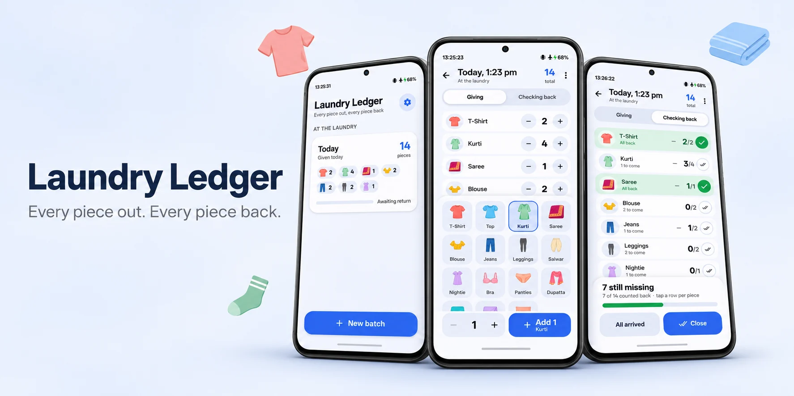
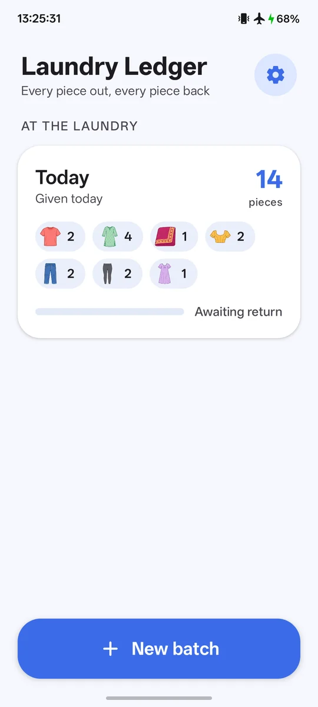
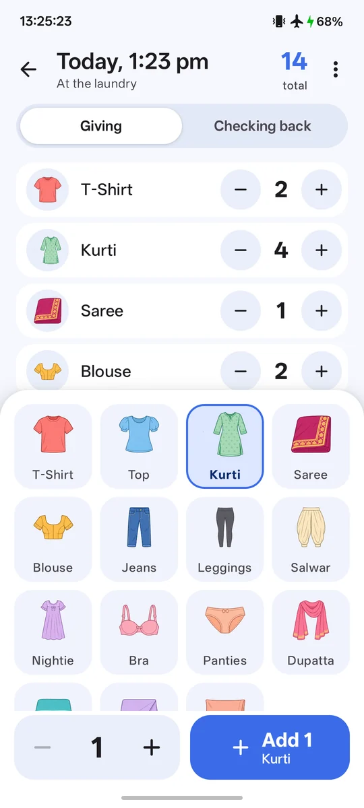
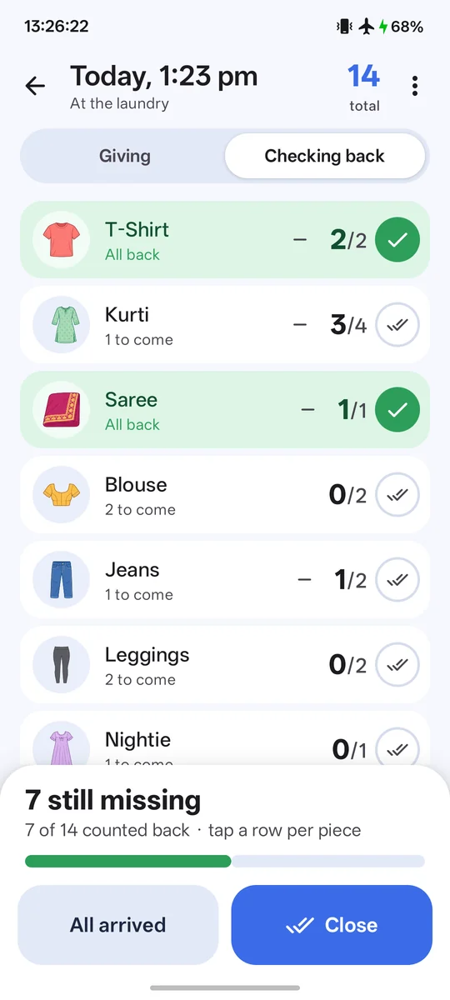
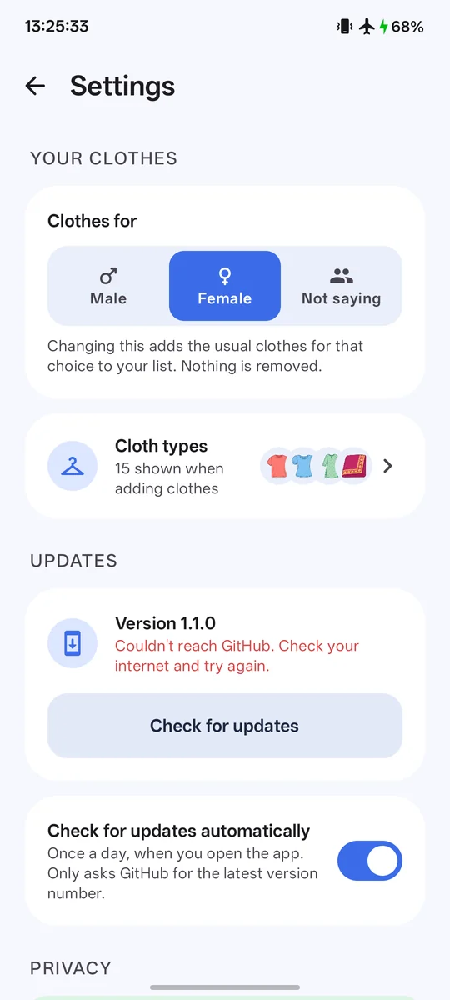
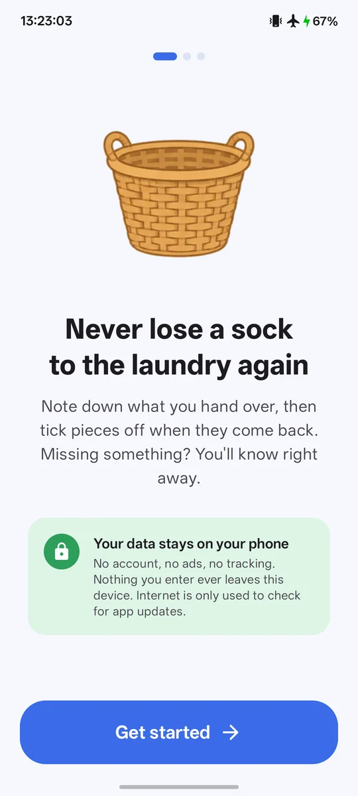
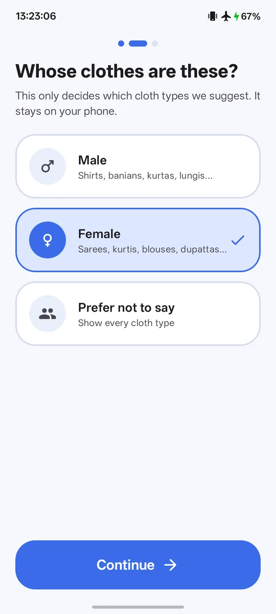
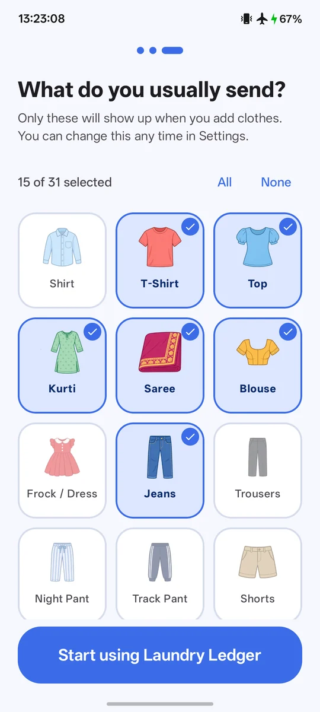

<div align="center">



# Laundry Ledger

**Keep count of every piece you give to the laundry, then check them off when they come back.**

[](https://github.com/mrbeandev/LaundryLedger/releases/latest)
[](#install)
[](LICENSE)
[](https://github.com/mrbeandev/LaundryLedger/actions/workflows/ci.yml)

</div>

You hand over a pile of clothes, the laundry hands back a pile a few days later, and somewhere in between a sock goes missing. Laundry Ledger is a small offline app for that. Note what you give, tap each piece as it comes back, and the app tells you what's still missing.

## Download

Get the latest APK from **[Releases](https://github.com/mrbeandev/LaundryLedger/releases/latest)** and open it on your phone. Android may ask you to allow installs from your browser or file manager the first time.

After that, the app checks for updates by itself. You can also update from **Settings > Check for updates** with one tap.

## Screenshots

<p align="center">
  
  
  
  
</p>

<p align="center">
  
  
  
</p>

## Features

- **Fast entry.** Large cloth tiles, a quantity stepper and one Add button, all within thumb reach. Adding the same type again adds to its count.
- **Remembers your habits.** It keeps your last cloth type and the quantity you usually use for each type, so 4 shirts and 2 towels are already filled in next time.
- **Only your clothes.** On first launch, pick Male, Female or Prefer not to say, then choose the clothes you actually send. There are 35 types, from shirts, banians and lungis to sarees, kurtis and dupattas, plus towels, bedsheets and blankets. You can change this any time in Settings.
- **Check returns piece by piece.** Tap a row for each piece that comes back. Rows turn green when complete, and a bar shows how many are still missing.
- **Batches at a glance.** Clothes still at the laundry are shown at the top, past batches below in History, with any missing pieces flagged.
- **Safe edits.** Removing an item can be undone. Deleting a batch asks first. A new batch left empty is discarded on its own.
- **One-tap updates.** The app checks GitHub Releases once a day, shows a banner when a new version is out, then downloads and installs it.
- **Smooth to use.** Animated screen transitions, rolling numbers, springy buttons, haptic feedback, light and dark themes.

## Privacy

Laundry Ledger has **no account, no ads, no analytics and no tracking**. Everything you enter stays in a local database on your phone.

The app has one network request. It asks `api.github.com` for the latest release of this repository and downloads the APK only when you tap Update. No personal data is sent, and you can switch off automatic checks in Settings.

Cloud backup is turned off. Moving to a new phone with Android's device-to-device transfer brings your ledger along.

## Install

1. Download `LaundryLedger-vX.Y.Z.apk` from [Releases](https://github.com/mrbeandev/LaundryLedger/releases/latest).
2. Open it and allow "Install unknown apps" for your browser when asked.
3. Optional: check the file against `SHA256SUMS.txt` from the same release.

Google Play Protect may warn about an app it hasn't seen before, because Laundry Ledger isn't on the Play Store. Tap **More details > Install anyway**. The source is all here if you want to check it or build it yourself.

Requires Android 8.0 (API 26) or newer.

## Build from source

You need JDK 17+ and the Android SDK (platform 35).

```bash
git clone https://github.com/mrbeandev/LaundryLedger.git
cd LaundryLedger
./gradlew testDebugUnitTest assembleDebug
# app/build/outputs/apk/debug/app-debug.apk
```

Tech: Kotlin, Jetpack Compose (Material 3), Room, Navigation Compose. No third-party SDKs.

```
app/src/main/java/dev/mrbean/laundryledger/
├── data/      Room entities + DAO, cloth catalog, preferences
├── update/    GitHub release check, APK download, PackageInstaller
└── ui/        Compose screens: onboarding, home, batch, settings
```

## Releasing

Releases are built and published by GitHub Actions ([`release.yml`](.github/workflows/release.yml)).

```bash
# optional: write release-notes/v1.2.0.md, otherwise notes come from commit messages
git tag v1.2.0
git push origin v1.2.0
```

The workflow runs the tests, builds a signed release APK with `versionName` taken from the tag, and attaches `LaundryLedger-v1.2.0.apk` and `SHA256SUMS.txt` to a new GitHub release. Installed apps pick it up through the update checker.

Signing uses these repository secrets: `SIGNING_KEYSTORE_BASE64`, `SIGNING_STORE_PASSWORD`, `SIGNING_KEY_ALIAS`, `SIGNING_KEY_PASSWORD`.

## Contributing

Issues and pull requests are welcome. Missing a cloth type you often send? Open an issue.

## License

[MIT](LICENSE)
